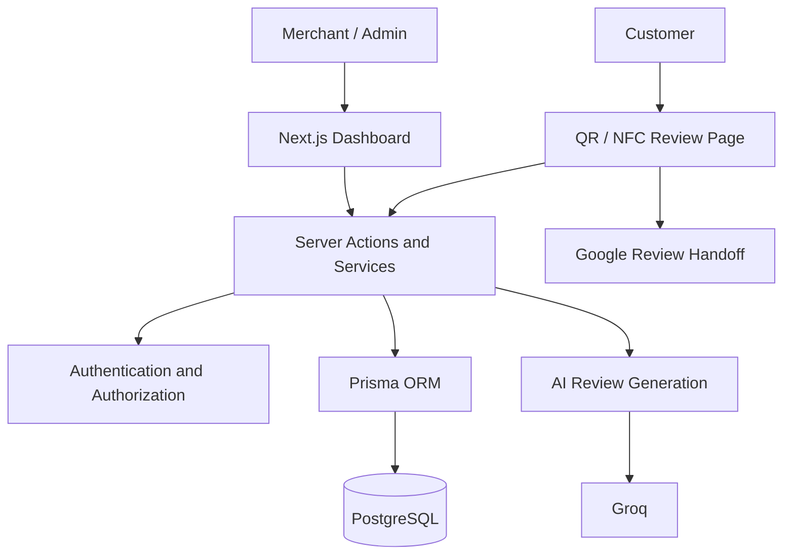

# ReviewDesk — AI-Powered Review Management Platform

A full-stack, multi-tenant review management platform
that helps businesses manage customer feedback through
QR codes, NFC, AI-assisted reviews, and analytics.

## Overview

ReviewDesk is an independently developed full-stack
application demonstrating multi-tenant architecture,
AI integration, secure authentication, role-based
authorization, relational database design, and
responsive dashboard development.

## Key Features

- Multi-tenant merchant management
- Business and branch management
- QR code generation and NFC-compatible review links
- AI-assisted customer review generation
- Google Review handoff
- Merchant and administrator dashboards
- Review analytics and conversion tracking
- Role-based access control (RBAC)
- Server-side tenant isolation
- Responsive mobile-first interfaces
- Unit, integration, and end-to-end tests

## Technology Stack

| Layer | Technologies |
|---|---|
| Frontend | Next.js 16, React 19, TypeScript |
| UI | Ant Design 6, Tailwind CSS 4 |
| Backend | Next.js Server Actions, Server Components |
| Database | PostgreSQL |
| ORM | Prisma 7 |
| Authentication | Auth.js, JWT, bcrypt |
| Authorization | RBAC, Tenant-based access control |
| AI Integration | Groq SDK |
| Validation | Zod |
| Testing | Playwright, Node.js Test Runner |
| Code Quality | ESLint, Prettier |

## Engineering Highlights

### Multi-Tenant Architecture

Merchant data is isolated through server-side ownership
validation and tenant-scoped database queries.

### Authentication and Authorization

Auth.js Credentials, bcrypt password hashing, JWT sessions,
role-based permissions, and server-side authorization checks.

### AI-Assisted Review Workflow

Customers access a public review page through QR or NFC,
select their experience, generate review suggestions,
edit their preferred review, and manually submit it to Google.

### Data Integrity

Relational database modeling, unique constraints,
indexed ownership relationships, and idempotent
review-session interactions.

### Testing Strategy

Unit, integration, and end-to-end tests cover validation,
authentication, tenant isolation, business management,
QR workflows, and analytics.

## System Architecture

## Author

**Khurshed Khan**

Senior Frontend & Full-Stack Developer | 9+ Years

- [Portfolio](https://www.khurshedkhan.dev/)
- [GitHub](https://github.com/khurshed52)

---

## Technical Documentation

